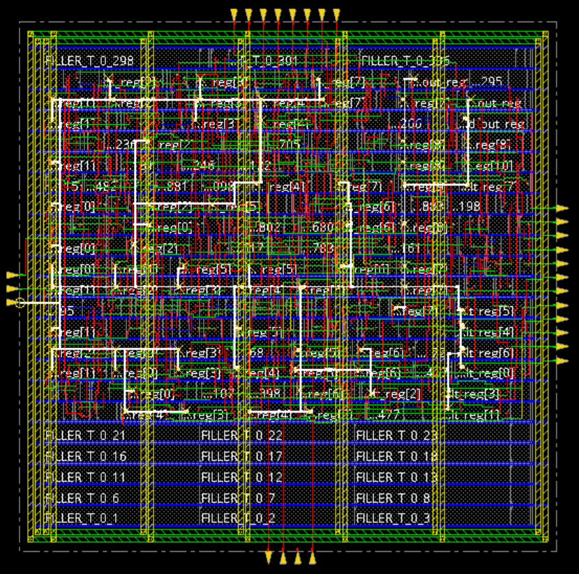
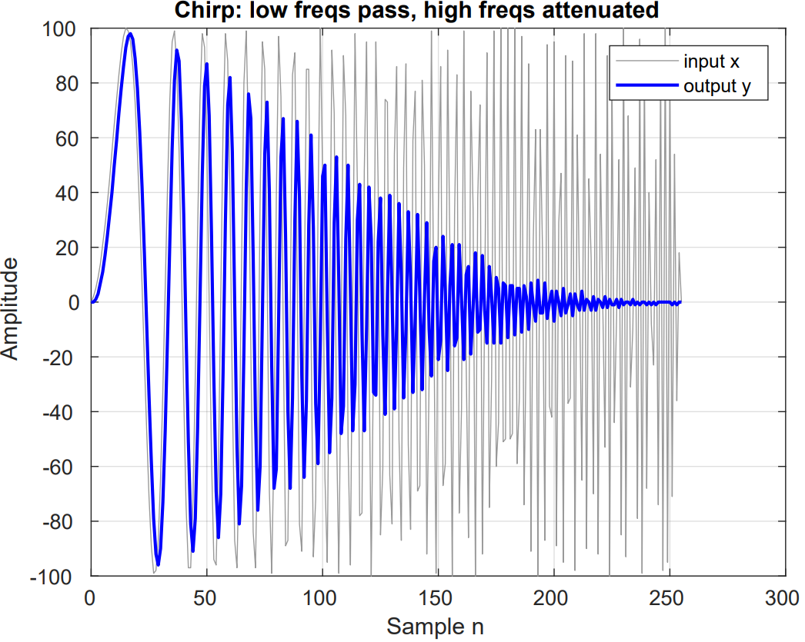
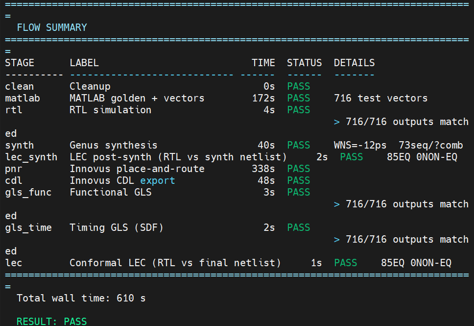
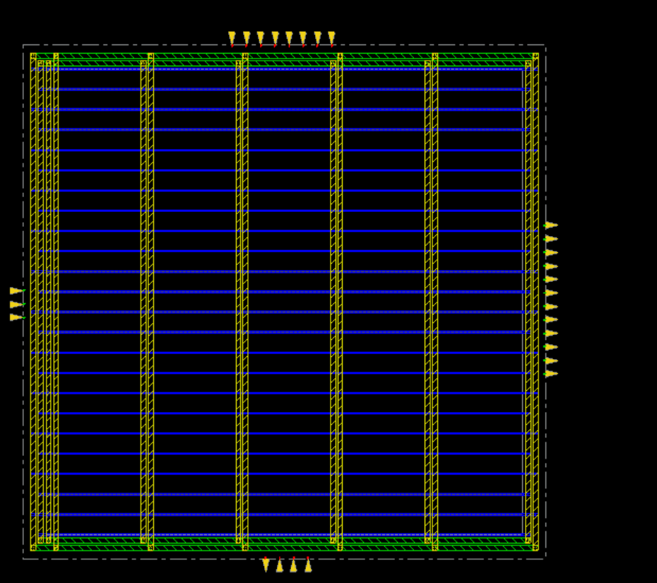

# fir4: a digital filter from code to chip

**Lia Surguladze** · VLSI Circuit Design · San Diego State University · Fall 2026

I took a small digital filter all the way from a MATLAB model to a finished **45 nm chip layout** that runs at **300 MHz**, using the Cadence tool flow (Xcelium, Genus, Innovus, Conformal).


*The final routed layout. White lines are the clock tree reaching all 73 flip-flops.*

## What the filter does

fir4 is a low-pass filter. It keeps slow signals and removes fast wiggles. Each output is a weighted average of the last 4 inputs:

```
y[n] = ( x[n] + 3·x[n-1] + 3·x[n-2] + x[n-3] ) / 8
```


*Chirp test in MATLAB: the input (grey) speeds up over time. The output (blue) follows the slow part and fades out on the fast part, which is what a low-pass filter should do.*

## Results

| Check | Result |
|---|---|
| Full flow | **11 / 11 stages pass** |
| RTL simulation | 716 / 716 outputs match the MATLAB model |
| Gate-level simulation (functional and with real delays) | 716 / 716 match |
| Equivalence check (RTL vs final netlist) | 85 equal, 0 different |
| Setup timing at signoff | **+929 ps** slack, 0 violations |
| Hold timing at signoff | +34 ps slack, 0 violations |
| Antenna violations | 0 |
| Size | 170 cells, 73 flip-flops, 1104 µm², 215.7 µW |



## How I built it

1. **MATLAB golden model.** Two models: an exact one, and a hardware one that drops fractions the same way the chip does. The hardware model makes the 716 test vectors.
2. **SystemVerilog RTL.** A 3-stage pipeline, so each clock cycle only does one small job:
   - Stage 1: two additions (9-bit)
   - Stage 2: ×3 done as `x + 2x` (shift and add, no multiplier)
   - Stage 3: final add, then divide by 8 with a shift
3. **Synthesis (Genus).** Turned the Verilog into real 45 nm gates, added a scan chain, and checked the netlist against the RTL with Conformal LEC.
4. **Place and route (Innovus).** Floorplan, power ring and stripes, placement, clock tree, routing, and signoff timing across slow and fast corners.
5. **Verification.** Gate-level simulation with and without SDF delays, plus a final equivalence check.

Timing got better through the flow: slack went from −12 ps after synthesis to **+929 ps** at signoff, because Innovus optimized with real placement and real wires.



## What I learned

A green PASS isn't always correct. Three times a stage said PASS but didn't do its job: my MATLAB script never wrote the test vectors, synthesis skipped the timing report because a setup file hadn't saved, and the CDL export folder was empty. I learned to check the logs and output files, not just the status line.

## Files

| Folder | What's inside |
|---|---|
| `matlab/` | golden model, test vector generator, plots |
| `rtl/` | `fir4.sv`, the 3-stage pipelined filter |
| `tb/` | `tb_fir4.sv`, testbench that compares every output to MATLAB |
| `constraints/` | `fir4.sdc`, 300 MHz clock and I/O timing |
| `scripts/` | Genus synthesis setup and scripts, RTL and gate-level simulation |
| `fv/fir4/` | Conformal LEC scripts (after synthesis and final) |
| `innovus/scripts/` | place-and-route steps 01–06, MMMC setup, CDL export |
| `images/` | layout, plots, and results |

The Cadence tools and the 45 nm library come from the course setup and are not included.
